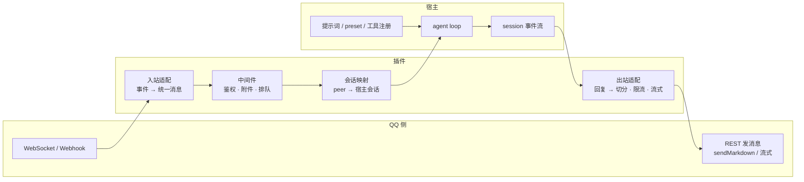

# QQ Bot 渠道插件模式

把 QQ 机器人接入某个 Agent 宿主（Harness）时，`tencent-connect/dsh-qqbot` 与 `tencent-connect/openclaw-qqbot` 呈现出同一套分层结构。本文提炼其共同骨架，供本项目（`pi-qqbot`）参考。

## 骨架

四条边界，缺一条都会把宿主与渠道耦死。

## 1. 入站只做翻译

QQ 事件（C2C 私聊、群聊、频道、按钮 interaction）转成宿主统一输入，不在此处做业务判断。鉴权、去重、附件落盘、历史缓冲放在中间件里，串联而非嵌套。

## 2. 会话映射是唯一状态源

- 路由键形如 `qqbot:${appId}:${scope}:${peerId}`：`appId` 区分多机器人实例，`scope` 区分私聊/群聊，`peerId` 是 QQ openid（不是 QQ 号）。
- 映射持久化（`model-prefs.json`）而非每次派生。dsh-qqbot 的教训（0.5.4）：早期用「哈希派生确定性会话 id」，跨进程必然相同，两进程并发新建会把同一 id 写进不同目录，宿主随后拒绝加载整个会话列表；改为新会话铸造 `session-<UUID>`、派生 id 只用于迁移存量。
- 并发入口（斜杠命令与普通消息同时到达）必须合并成一次恢复/创建，否则产生两个互相覆盖且无人回收的会话实例。

## 3. 出站是事件订阅者

宿主的 session 事件流是唯一回复来源，插件按事件组装文本再发送。要点：

- Markdown 感知切分（代码块、表格不截断），`textChunkLimit` 默认 4500。
- 流式输出只在私聊启用；群聊不启用，避免刷屏。
- 消息 id 缓存 + 回复限流，防止重试导致重复发送。
- 被动回复窗口：QQ 对「回复某条消息」有一次性额度，长任务与主动推送要区分处理，否则发送失败。

## 4. 通道能力映射到宿主原语

QQ 的交互形态要映射成宿主已有原语，不自造协议：

| QQ 能力 | 宿主原语（dsh 侧） |
| --- | --- |
| 斜杠命令 | 插件内命令表（不进模型上下文） |
| 内联按钮（单选/多选） | `ask_user_question` |
| 允许/拒绝按钮 | `approval/request` |
| 发图片/文件 | 工具注册（`qqbot_describe_image`、`qqbot_send_file`） |
| 群聊 @ 触发 | 配置项 `requireMention` + 场景提示词 |

审批与提问按钮必须绑定唯一标识并校验点击者身份，否则旧卡片点击可越权（dsh-qqbot 0.5.4 修复过）。

## 5. 凭据与绑定

免手填绑定的路径：`@tencent-connect/qqbot-connector` 扫码 → 拿到 AppID/AppSecret → 写入宿主的配置层（dsh 写 profile 的 `cordis.patch.yml` 触发热更新）→ 不写 `process.env`。写环境变量会与解绑清理不对齐：解绑后热重载的新实例仍能读到旧凭据，状态卡在「已绑定」。

绑定期间不要 `await` 用户扫码，否则阻塞宿主启动（dsh 的 `loader.await()` 会等插件树稳定）。

## 6. 宿主版本漂移要收口

宿主 API 在小版本内会变（`events` getter → `snapshotEvents()`、实例方法 → 模块函数、子路径导出增删）。dsh-qqbot 用单一 `host/adapter.ts` 收口全部漂移点，调用方只依赖稳定签名。这是维持跨宿主版本兼容的最省力做法。

## 复用清单

接入新宿主时，先确认以下各点在该宿主上的等价物，再动手：

- [ ] 插件入口与依赖声明方式（谁能拿到 agent 注册表）
- [ ] 会话创建/恢复/释放接口，是否有「写句柄占用」概念
- [ ] session 事件流的订阅方式与事件形状
- [ ] 提问、审批、工具注册、preset 四类原语是否存在
- [ ] 配置持久化位置与热重载机制
- [ ] 浏览器可写接口是否已由宿主统一鉴权
