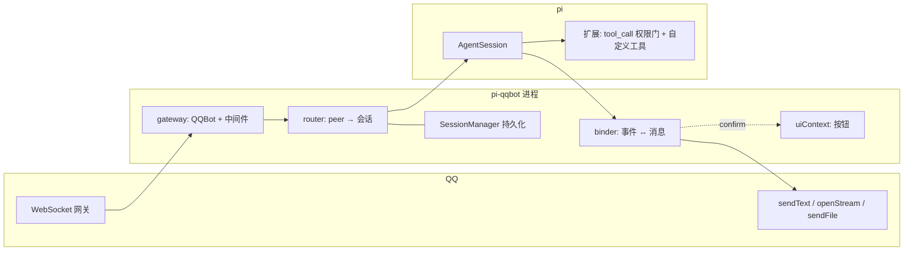

# ADR-001：pi agent 接入 QQ Bot 的桥接方案

## 背景（现状与约束）

项目目录 `pi-qqbot` 的目标是把 pi（`@earendil-works/pi-coding-agent`，本机 1.6.1）接入 QQ 机器人，形态对标 [dsh-qqbot](../entities/dsh-qqbot.md)（Plugins-not-loop-changes 的渠道插件）。

pi 侧已验证的边界：

| 边界 | 能力 | 关键事实 |
| --- | --- | --- |
| SDK（进程内） | 完整 | `createAgentSession()` 返回 `AgentSession`：`prompt/steer/followUp/abort/compact/setModel/cycleModel/setThinkingLevel/getSessionStats/subscribe/dispose`；`SessionManager.create/open/continueRecent/inMemory` 管持久化 |
| RPC（子进程） | 完整 | `pi --mode rpc`，JSONL 命令与事件；`RpcClient` 是官方 TypeScript 封装；扩展 UI 走 `extension_ui_request`/`extension_ui_response` 子协议 |
| 扩展（进程内） | 不完整 | 扩展只能挂 `tool_call`/`tool_result`/`input` 等钩子并注册工具与命令，`ExtensionContextActions` 里没有「提交用户消息」的入口，**无法主动发起一次 run** |

QQ 侧已验证的边界：`@tencent-connect/qqbot-nodejs`（1.0.5）已提供 WebSocket/Webhook 双传输、Koa 洋葱中间件（错误处理、去重、限流、并发守卫、访问策略、@ 门控、历史缓冲、信封格式化、输入中提示、斜杠命令框架）、`sendText/sendImage/sendFile`、C2C 流式消息 `openStream()`、`message`/`interaction` 事件与重连生命周期。协议层无需自研。

结论：桥接必须由**宿主进程**驱动 agent run，扩展只补工具与权限门。

## 备选方案

### 方案 A：进程内 SDK 桥接（单服务进程）

一个 Node 服务同时持有 QQ 连接与 N 个 `AgentSession`。

- 入站：`bot.on("message")` → 解析 `scope`/`peerId` → 取或建会话 → `session.prompt(text, { images, streamingBehavior })`。
- 出站：`session.subscribe()` 聚合 `message_update` 的 `text_delta`；私聊用 `bot.openStream()` 实时更新，群聊按段 `sendText`（QQ 流式仅 C2C）。
- 工具活动：`tool_execution_start`/`tool_execution_end` 渲染成短行，`showToolResults` 控制成功结果是否展示。
- 结束判定：`agent_settled` 而不是 `agent_end`（后者之后仍可能有重试、压缩、排队工作）。
- 会话：`SessionManager.create(cwd, sessionDir)` 每 peer 一份，映射表落盘；SIGTERM 时 `dispose()`。

优点：零进程开销、事件直通、调试简单、类型共享；官方 SDK 就是为这种用法准备。
缺点：任一会话的扩展或工具异常与主进程同生命周期；模型调用与 QQ 心跳共享事件循环（发放到 IO 的负载很轻，实际风险低）。

### 方案 B：RPC 子进程

每 peer（或每租户）一个 `pi --mode rpc` 子进程，主进程只做 QQ 收发。

优点：崩溃隔离、可对不同 peer 用不同凭据/配置、可换语言写客户端。
缺点：进程数与内存随活跃会话增长、冷启动延迟、扩展 UI 要自己走 JSONL 子协议、日志与超时都要自行管理。

### 方案 C：写成 pi 扩展（在 pi 进程里跑 QQ 网关）

优点：与 pi 同进程，最容易拿到会话内上下文。
缺点：**不可行**。扩展没有提交用户消息、发起 run 的入口，无法把 QQ 入站变成一次对话回合。

## 决策

采用**方案 A（进程内 SDK 桥接）**，扩展只承担两件事：工具权限门（`pi.on("tool_call")` + `ctx.ui.confirm`）与 QQ 专用工具（发文件、读图描述）。

进程内若要给用户确认按钮：SDK 允许 `session.bindExtensions({ uiContext, mode })` 注入自定义 `ExtensionUIContext`，把 `confirm`/`select` 映射成 QQ 内联按钮，`interaction` 事件回填结果。这是方案 A 唯一需要新写的适配层。

## 理由

1. 能力完整度决定方案：扩展无法发起 run，方案 C 直接出局；方案 A 与 B 能力等价，A 少一层进程与协议。
2. QQ 侧 SDK 已覆盖渠道复杂度（重连、限流、去重、@ 门控、流式），主进程工作量集中在「事件 ↔ 消息」翻译，与 dsh-qqbot 的结构同构，已有可复用经验。
3. RPC 的隔离收益在「不可信用户 + 高危工具」场景才成立；本项目先用「受限 cwd + 工具白名单 + 访问白名单」在 SDK 模式达到同等安全线，需要更强隔离时按 peer 拆分进程不改接口。
4. 实机验证过核心链路：进程内 `createAgentSession({ sessionManager: SessionManager.inMemory(), tools: [] })` → `prompt("只回复两个字：就绪")` 返回"就绪"，事件序列为 `agent_start → turn_start → message_start → message_update → message_end → turn_end → agent_end → agent_settled`。

## 落地结构



模块划分（照 dsh-qqbot 的经验裁剪，不预先拆分）：

| 模块 | 职责 | 是否首版需要 |
| --- | --- | --- |
| `config` | AppID/Secret、cwd、模型、工具白名单、访问控制、超时 | 必须 |
| `gateway` | `new QQBot(...)` + 中间件编排 + 事件注册 + 生命周期 | 必须 |
| `router` | `scope/peerId` → `AgentSession`，映射表落盘、闲置回收 | 必须 |
| `binder` | session 事件 → QQ 消息（切分、流式、工具行、错误） | 必须 |
| `commands` | `/new /stop /model /compact /status /help` | 必须 |
| `tools` | `qqbot_send_file`、`qqbot_describe_image` | 可选 |
| `ui` | 自定义 `ExtensionUIContext`，按钮审批与提问 | 可选 |

## 关键实现点（已验证的 API）

```ts
// 入站：一条 QQ 消息 → 一次 run
const { session } = await createAgentSession({
  cwd: config.cwd,
  tools: config.tools,          // ["read","grep","bash"] 之类的白名单
  sessionManager: SessionManager.create(config.cwd, sessionDir),
  settingsManager: SettingsManager.create(config.cwd, agentDir), // 或 inMemory，避免继承个人配置
});

// 会话忙时：steer（插话）与 followUp（排队）二选一，prompt() 不带 streamingBehavior 会抛错
await session.prompt(text, { images, streamingBehavior: "followUp" });

// 出站
session.subscribe((e) => {
  if (e.type === "message_update" && e.assistantMessageEvent.type === "text_delta") buffer += e.assistantMessageEvent.delta;
  if (e.type === "tool_execution_start") sendToolLine(e.toolName);
  if (e.type === "agent_end") flush(buffer);        // 一轮结束，但可能还有重试/排队
  if (e.type === "agent_settled") finish(buffer);   // 确认不再自动继续
});

// 命令
await session.abort();                    // /stop
await session.compact();                  // /compact
await session.setModel(model);            // /model
session.modelRuntime.getAvailable();      // 列出可用模型
session.getSessionStats();                // /status
```

## 后果（影响与后续）

- 会话映射表（peer → 会话文件）是唯一状态源，必须原子写并处理多实例并发，否则「QQ 里丢上下文」且无从排查（dsh-qqbot 踩过）。
- pi 没有内置工具审批。默认必须「访问白名单 + 受限 cwd + 最小工具集」；放开 shell 工具前必须接权限门，否则群消息等于远程命令执行入口。
- 群聊不能流式（QQ 限制 C2C），长回复按 4500 字符切分；QQ 被动回复窗口对「回复某条消息」只有一次额度，主动推送需在开放平台开通。
- 待验证（阻塞项）：QQ 侧凭据与实际收发未验证（本机无 `QQBOT_APPID`/`QQBOT_SECRET`）；图片入站是否走 `prompt({ images })` 需在真机确认 QQ 附件下载后可直接喂给 `ImageContent`。
- 后续若要隔离不可信用户，按 peer 切换到方案 B（RPC）而不改路由与 binder 接口。

## 实现与验证（2026-11-27）

方案已按本文落地，模块与验证记录见 [pi-qqbot](../entities/pi-qqbot.md)。落地时确认的两点调整：

- 发送用纯文本（`bot.sendText`）而非 Markdown：Markdown 需平台单独开通权限，纯文本在私聊与群聊表现一致。
- 工具审批仍未实现：以「白名单为空即全拒（首次消息回 openid 自助加入）+ 独立工作目录 + 工具集收窄」代替，代价是白名单用户拥有完整 shell。

真实验证：QQ 平台取 token 后 WebSocket READY；真实 pi 会话完成 prompt → 工具调用 → 流式文本 → 落盘 → 恢复的全链路。

## 参考

- [QQ Bot 渠道插件模式](../concepts/qqbot-channel-plugin.md) —— 通用骨架与踩坑清单
- [dsh-qqbot](../entities/dsh-qqbot.md) —— 同赛道的完整实现对照
