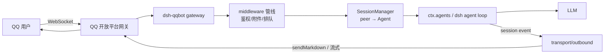

# dsh-qqbot

腾讯 QQ 开放平台团队（GitHub 组织 [tencent-connect](tencent-connect-org.md)）维护的 QQ Bot 渠道插件，把 DeepSeek Harness（dsh）的 Agent 能力接到 QQ 私聊与群聊。仓库：<https://github.com/tencent-connect/dsh-qqbot>；npm 包 `@tencent-connect/dsh-qqbot`。

## 一句话定位

dsh 是「一切皆插件」的 Agent 宿主（Cordis 依赖注入框架），dsh-qqbot 是它的一个纯插件：不修改宿主 agent loop，只声明 `inject = ['agents']`，把 QQ 消息流翻译成宿主会话事件，再把宿主回复翻译回 QQ 消息。

## 仓库事实（2026-11-27 采集）

| 项 | 值 |
| --- | --- |
| 许可 | MIT |
| 语言 | TypeScript（源码约 960 KB，另有 Shell、JavaScript 少量） |
| 创建 | 2026-08-14 |
| 最新发布 | 0.5.5（2026-10-30；npm 同步 0.5.5） |
| 最后推送 | 2026-11-24 |
| 星标 / fork | 633 / 78 |
| 未关闭 issue | 47 |
| 提交数 | 94（2026-08-14 至 2026-11-24） |
| 主要提交者 | cxyhhhhh（87 次），另有 6 位外部贡献者各 1–2 次 |
| 默认分支 | main |
| 话题标签 | dsh、dsh-plugin、qqbot |
| 代码规模 | `src/` 170 个文件、58 个测试文件；`lib/` 为 `tsc` 构建产物（94 个文件） |

## 技术栈与依赖

- 运行时：Node.js ≥ 20.3.0，纯 ESM（`"type": "module"`）。
- 构建/测试：`tsc` + `tsdown`（浏览器端 bundle）、`vitest`、`eslint`。
- 直接依赖：
  - `@tencent-connect/qqbot-nodejs` ^1.0.5 —— QQ 开放平台官方 Node SDK，提供 REST、WebSocket/Webhook 双传输、Koa 风格中间件管线、C2C 流式消息。
  - `@tencent-connect/qqbot-connector` 1.2.0 —— 「扫码连接 QQ 机器人，获取 AppID 与 AppSecret」的 SDK，用于免手填凭据的绑定流程。
  - `qrcode`、`js-yaml`、`yaml`。
- peer 依赖（由宿主提供）：`@deepseek-ai/cordis` ≥4.0.1、`dsh-agent`、`dsh-session`、`dsh-llm`、`dsh-user-approval`（均 ≥0.2.0-rc.2）、`schemastery`。
- 兼容性声明写在 `package.json` 的 `dsh.compatibility.dshReleases`：已验收宿主 0.2.0-rc.2（桌面内嵌运行时）与 0.2.2-rc.1（运行时冒烟），类型与单测基线锁到 0.2.2-rc.3。

## 运行架构

入站：QQ 事件 → `handleInbound` → SessionManager 解析/恢复会话 → dsh agent。出站：监听宿主 session 事件 → `createOutboundHandler` → Markdown 切分/流式写入 → QQ。浏览器可写面（绑定页、设置页、配对）全部挂在宿主 `/api` 共享通道，来源校验与登录认证由宿主施加。

## 源码模块划分（`src/`）

| 目录 | 职责 |
| --- | --- |
| `transport/`（29 文件） | 入站、出站、流式写入、切分、回复限流、msgid 缓存、交付物投递、工具结果呈现 |
| `client/`（28 文件） | 宿主 Web 界面侧：设置面板、扫码绑定页、白名单导出、RPC 调用、样式与席位 |
| `shared/`（17 文件） | 协议常量（bind/pairing/rpc/command）、目录解析、原子写、会话提示 |
| `runtime/`（14 文件） | 账号与成员存储、配对服务、配置 RPC、模型选项 |
| `setup/`（11 文件） | 凭据绑定编排：扫码状态机、绑定路由、凭据持久化、二维码 SVG |
| `commands/`（11 文件） | QQ 斜杠命令（session/model/preset/status/help/misc/auth） |
| `session/`（10 文件） | SessionManager、会话 id 铸造与迁移、闲置回收、错误分类 |
| `prompt/`（10 文件） | 通道声明、人设、场景补充提示词、按作用域安装提示词 |
| `features/`（9 文件） | 提问通道与渲染、审批通道与渲染、按钮工具、群历史缓冲 |
| `media/`（7 文件） | 富媒体下载与清理、`qqbot_send_file`、`qqbot_describe_image` |
| `model/`（6 文件） | provider/model 解析、偏好持久化 |
| `middleware/`（4 文件） | 附件、消息处理（排队/插话）、问答回落 |
| `gateway/`（4 文件） | 组装 bot、编排中间件、注册事件与生命周期 |
| `host/`（2 文件） | 宿主 API 适配层，收口版本漂移（`events`→`snapshotEvents`、`presets.serviceFor`→`serviceForAgent`、`./fork` 导出等） |

## 会话模型

- 路由键：`qqbot:${appId}:${scope}:${peerId}`；私聊 `peerId` 为用户 openid，群聊为群 openid。
- 新会话铸造 `session-<UUID>` 并写入 `model-prefs.json`，重启按持久化 id 恢复；0.5.x 的 SHA-256 确定性派生 id 只用于迁移存量会话，不再用于新建（确定性 id 跨进程必然相同，两进程各自新建会把同一 id 写入不同 project 目录）。
- 解析顺序：进程内复用 → 持久化恢复 → 新建；同一会话的并发请求合并为一次恢复/创建。
- 闲置回收：默认 30 分钟 dispose Agent（`sessionIdleTimeout <= 0` 关闭）。

## 配置面（`ConfigSchema`）

基础：`appId`/`appSecret`（或环境变量 `QQBOT_APPID`/`QQBOT_SECRET`）、`provider`、`model`、`preset`、`cwd`、`requireMention`（默认 true）、`groupPrompt`/`directPrompt`、`textChunkLimit`（4500）、`streaming`（默认 true，群聊始终关闭）、`sessionIdleTimeout`（1800000）、`processingTimeoutMs`（1800000）、`maxQueue`（20）、`messageHandlingMode`（`queue`/`interrupt`）、`historyLimit`（10）、`askTimeoutMs`（300000）、`showToolResults`（false）、`debug`。

| 分组 | 关键项 |
| --- | --- |
| 访问控制 `access` | `c2cMode`/`groupMode`/`commandMode`（`open`/`allowlist`/`disabled`）+ 三份白名单；写接口带 `accessRevision` 乐观锁（冲突返回 409） |
| 主动推送 `proactiveDelivery` | `externalTurns`：`off`/`c2c`/`all` |
| 富媒体 `media` | `enabled`、`maxMB`（200）、`ttlHours`（24） |
| 视觉理解 `vision` | `enabled`、`provider`、`model`、`maxBytes`、`maxTokens`、`timeoutMs` |
| 附件发送 `sendFile` | `restrictPaths`（默认 true）、`extraRoots`、`sendPresentedFiles`、`maxFiles` |

## 对外能力

- 内置命令：`/new`（`/reset` `/clear`）、`/compact`、`/unarchive`（`/restore`）、`/model`、`/preset`、`/stop`、`/bot-ping`、`/bot-version`、`/bot-status`、`/bot-help`，以及 0.5.4 新增的 `/bot-me`。
- 模型可调用的工具：`qqbot_describe_image`（视觉理解）、`qqbot_send_file`（发本地文件，默认路径白名单，符号链接按真实位置判定）。
- 交互：`ask_user_question` 生成内联单选按钮/多选编号，逐题推进并有问题级超时；`approval/request` 用「允许/拒绝」按钮确认敏感操作。问题同时发到 QQ 与桌面，先答先赢。
- 交付物：模型通过 present 声明的文件在轮末自动发到当前会话。
- 粘性行为：QQ 入站回合始终被动回复；非 QQ 输入（桌面续聊该会话、宿主定时任务）的回合按 `proactiveDelivery` 主动推送，需在 QQ 开放平台开通主动消息。

## 安装与二次开发

四种安装路径：桌面端插件页添加（`@tencent-connect/dsh-qqbot@latest`）→ 设置页扫码连接；`npx @deepseek-ai/dsh plugin --profile qqbot add @tencent-connect/dsh-qqbot` 后扫码绑定；本地路径安装；`dsh web --patch ./cordis.dev.yml` 开发模式。凭据写入 profile 的 `cordis.patch.yml` 触发宿主热更新重载，不写 `process.env`（避免与解绑清理不对齐）。

## 版本轨迹

| 版本 | 日期 | 关键变化 |
| --- | --- | --- |
| 0.4.0 | 2026-08-16 | 早期可用版本（README 建议 0.4.0 以上扫码） |
| 0.5.0 | 2026-09-08 | — |
| 0.5.1 / 0.5.2 | 2026-10-12 / 10-13 | 0.5.2 修复全新安装因旧版 SDK 启动崩溃 |
| 0.5.3 | 2026-10-27 | 流式回复真正生效；交付文件直达会话；操作确认恢复 |
| 0.5.4 | 2026-10-30 | `/bot-me`、管理指令白名单鉴权、访问控制默认收紧、工作目录独立、审批按钮鉴权 |
| 0.5.5 | 2026-10-30 | 修复端内绑定二维码裂图（`createRequire` 加载 qrcode） |
| 未发布 | — | 消息处理方式可切换、配对码白名单、命令权限独立、非 QQ 回合主动推送、`/unarchive`、浏览器可写面迁移到宿主 `/api`、最低宿主升至 0.2.0-rc.2 |

## 与同组织其他仓库的关系

- 与 [openclaw-qqbot](tencent-connect-org.md) 是同赛道两个宿主适配器：都依赖同一 SDK 栈（`qqbot-nodejs` + `qqbot-connector` 1.2.0），但宿主不同（OpenClaw 对 DeepSeek Harness）。两者无 fork 关系（`isFork = false`）。
- 上层 SDK 见 [qqbot-nodejs](tencent-connect-org.md#qqbot-nodejs)（协议层），扫码取凭据依赖 `@tencent-connect/qqbot-connector`（npm 独立发布，仓库不在该组织列表内）。

## 待确认

- `@tencent-connect/qqbot-connector` 的源码仓库位置：npm 元数据显示 1.2.0，但组织仓库列表中无对应项目，未验证是否闭源或位于其他组织。
- 47 个 open issue 的具体构成未逐条统计（只抽样到 2026-11 的 bug 报告），如需判断维护负载要另行采样。
