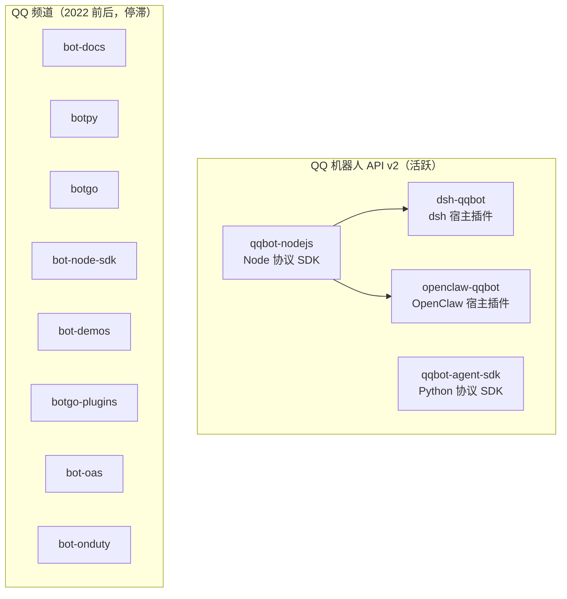

# tencent-connect 组织

<https://github.com/orgs/tencent-connect/repositories> —— 腾讯 QQ 开放平台（QQ 机器人 / QQ 频道）官方开源组织。官网 `https://bot.q.qq.com`，地区 China，创建于 2021-08-17，公开仓库 13 个，关注者 265。无组织级描述。

## 仓库清单（2026-11-27，按最后推送倒序）

| 仓库 | 语言 | 星标 | 最后推送 | 定位 |
| --- | --- | --- | --- | --- |
| [dsh-qqbot](dsh-qqbot.md) | TypeScript | 633 | 2026-11-24 | DeepSeek Harness 的 QQ Bot 官方插件（当前主线） |
| [qqbot-nodejs](#qqbot-nodejs) | TypeScript | 16 | 2026-11-23 | QQ 开放平台官方 Node.js SDK（API v2） |
| [openclaw-qqbot](#openclaw-qqbot) | TypeScript | 1554 | 2026-10-12 | OpenClaw 的 QQ Bot 渠道插件 |
| qqbot-agent-sdk | Python | 11 | 2026-05-07 | WebSocket Gateway + OpenAPI v2 的独立 Python SDK，零 Agent 框架依赖 |
| tencent-channel-community | — | 24 | 2026-04-29 | 腾讯频道社区管理技能包（v1.1.5，跨平台） |
| bot-docs | JavaScript | 272 | 2025-04-21 | QQ 频道机器人文档 |
| botgo | Go | 393 | 2024-12-27 | QQ 频道机器人 Go SDK |
| botpy | Python | 917 | 2024-09-14 | QQ 频道机器人 Python SDK |
| bot-node-sdk | TypeScript | 150 | 2023-11-29 | QQ 频道机器人 Node SDK |
| bot-demos | Python | 56 | 2022-06-02 | QQ 频道机器人新手教程 |
| bot-onduty | Python | 14 | 2022-05-12 | 频道开发者社区「值班小助理」机器人 |
| bot-oas | HTML | 7 | 2022-03-22 | Bot OpenAPI Spec V3 |
| botgo-plugins | Go | 6 | 2022-01-17 | botgo SDK 扩展组件 |

13 个仓库均未归档，全部公开。

## 三代技术线

- **活跃主线**：`qqbot-nodejs`（协议层）+ `dsh-qqbot` / `openclaw-qqbot`（宿主适配层）构成「SDK 在下、插件在上」的分层；Python 侧对应 `qqbot-agent-sdk`。
- **停滞旧线**：`bot-*` 系列是 QQ 频道时代的 SDK 与资料，最后推送集中在 2022–2025 年，最近一次是 2025-04 的 `bot-docs`。星标反而更高（botpy 917、botgo 393），属历史存量。

### qqbot-nodejs

`@tencent-connect/qqbot-nodejs`，QQ 开放平台 Node.js SDK。覆盖 HTTP REST、WebSocket / Webhook 双传输、Koa 风格中间件管线、消息收发、媒体上传（含大文件分片）、C2C 流式消息（`stream_messages`）。要求 Node ≥ 20、纯 ESM。源码含 `src/QQBot.ts` 与 `src/middleware/*`（访问策略、并发守卫、内容清洗、信封格式化、错误处理、历史缓冲）、`examples/`（playground、webhook、流式发送）。

### openclaw-qqbot

`@tencent-connect/openclaw-qqbot` v2.0.4，OpenClaw 宿主（<https://github.com/openclaw/openclaw>）的 QQ 渠道插件，1554 星，是该组织星标最高的新仓库。依赖与 dsh-qqbot 同源的 `qqbot-nodejs` + `qqbot-connector` 1.2.0，另带 `skills/`（qqbot-channel、qqbot-remind、qqbot-upgrade）与 `bin/qqbot-cli.js` 命令行。目录结构按 `outbound/commands/adapter/features/utils/dispatch/gateway/setup/middleware/tools` 分层，测试集中在根 `tests/`。

## 与 dsh-qqbot 的对比

| 维度 | dsh-qqbot | openclaw-qqbot |
| --- | --- | --- |
| 宿主 | DeepSeek Harness（Cordis 插件体系） | OpenClaw |
| 版本 | 0.5.5 | 2.0.4 |
| 模块组织 | 按领域细分 14 个目录，含 `client/`（宿主 Web UI）、`session/`、`prompt/`、`runtime/`（RPC 与账号） | 10 个目录，`adapter/` 承载宿主适配，`dispatch/` 承载投递 |
| 界面 | 端内设置面板 + 扫码绑定页（走宿主 `/api` 通道） | 插件自带 `bin/qqbot-cli.js` 与 skills |
| 共同点 | 同一 QQ 协议 SDK 栈、同一扫码取凭据方案、Markdown 切分与流式回复 | 同左 |

无 fork 关系，`dsh-qqbot.isFork = false`、`parent = null`。

## 待确认

- `@tencent-connect/qqbot-connector`（扫码取 AppID/AppSecret）的源码仓库不在本组织 13 个仓库中，来源待核验。
- `tencent-channel-community` 与 `qqbot-agent-sdk` 的维护状态：前者 2026-04 后停更，后者无仓库描述，用途边界未核实。
